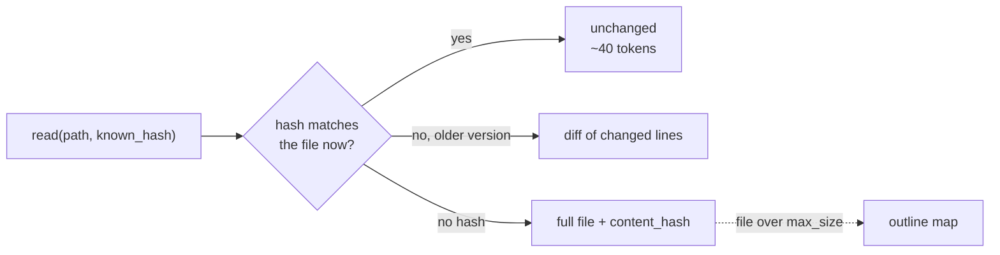

<p align="center">
  
</p>

<h1 align="center">Semantic Cache MCP</h1>

<p align="center">
  <strong>Stop paying for the same file twice.</strong><br />
  An MCP file cache for AI coding agents: a re-read costs ~40 tokens instead of the whole file.
</p>

<p align="center">
  <a href="https://pypi.org/project/semantic-cache-mcp/"></a>
  <a href="https://pypi.org/project/semantic-cache-mcp/"></a>
  <a href="https://www.python.org/downloads/"></a>
  <a href="LICENSE"></a>
</p>

<p align="center">
  <a href="https://glama.ai/mcp/servers/CoderDayton/semantic-cache-mcp"></a>
  &nbsp;
  <a href="https://ko-fi.com/U7U01WTJF9"></a>
</p>

<!-- mcp-name: io.github.CoderDayton/semantic-cache-mcp -->

---

Coding agents read the same files over and over: before an edit, after an edit, after every context compaction. A built-in `Read` sends the whole file each time.

Semantic Cache MCP replaces those reads with a cache that knows what your agent already holds. Measured on one 7,891-token source file:

| Read | Built-in `Read` | Semantic Cache MCP |
|------|----------------:|-------------------:|
| First read | 7,891 tokens | full file, plus a hash |
| Re-read, file unchanged | 7,891 tokens | **77 tokens** |
| Re-read after a one-line edit | 7,891 tokens | **137 tokens** (a diff) |

Across a whole 48-file project the benchmark saves **98.7%** of re-read tokens, and an unchanged read returns in **0.17 ms**.

It also gives your agent `grep`, keyword search and `glob` over the cache, safe edits with `dry_run`, and token-budgeted batch reads. 14 tools in all, three runtime dependencies, no API keys, no GPU.

**Works with** Claude Code, Cursor, VS Code (Copilot), Codex, OpenCode, Claude Desktop, and any other MCP client that runs a local stdio server.

---

## Quick start

You need [uv](https://docs.astral.sh/uv/getting-started/installation/). Pick your client:

<details open>
<summary><strong>Claude Code</strong></summary>

```bash
claude mcp add semantic-cache --scope user -- uvx semantic-cache-mcp
```

</details>

<details>
<summary><strong>Cursor</strong>: <code>~/.cursor/mcp.json</code></summary>

```json
{
  "mcpServers": {
    "semantic-cache": {
      "command": "uvx",
      "args": ["semantic-cache-mcp"]
    }
  }
}
```

</details>

<details>
<summary><strong>VS Code (Copilot)</strong>: <code>.vscode/mcp.json</code></summary>

```json
{
  "servers": {
    "semantic-cache": {
      "type": "stdio",
      "command": "uvx",
      "args": ["semantic-cache-mcp"]
    }
  }
}
```

</details>

<details>
<summary><strong>Codex</strong>: <code>~/.codex/config.toml</code></summary>

```toml
[mcp_servers.semantic-cache]
command = "uvx"
args = ["semantic-cache-mcp"]
```

</details>

<details>
<summary><strong>OpenCode</strong>: <code>~/.config/opencode/opencode.json</code></summary>

```json
{
  "$schema": "https://opencode.ai/config.json",
  "mcp": {
    "semantic-cache": {
      "type": "local",
      "command": ["uvx", "semantic-cache-mcp"],
      "enabled": true
    }
  }
}
```

</details>

<details>
<summary><strong>Claude Desktop and other clients</strong>: <code>mcpServers</code> JSON</summary>

```json
{
  "mcpServers": {
    "semantic-cache": {
      "command": "uvx",
      "args": ["semantic-cache-mcp"]
    }
  }
}
```

</details>

Restart the client. To pin a version instead of using uv's cached copy, install it once and point the client at the command:

```bash
uv tool install semantic-cache-mcp    # then use "command": "semantic-cache-mcp", no args
```

### Make your agent use it

Agents reach for their built-in file tools by habit. Turn those off so every read goes through the cache.

**Claude Code**: `~/.claude/settings.json`

```json
{
  "permissions": {
    "deny": ["Read", "Edit", "Write"]
  }
}
```

**OpenCode**: `~/.config/opencode/opencode.json`

```json
{
  "permission": {
    "read": "deny",
    "edit": "deny",
    "write": "deny"
  }
}
```

Then tell the agent why, in `CLAUDE.md`, `AGENTS.md` or your client's rules file:

```markdown
## Tools

- Use `semantic-cache` for all file reads, writes, edits, grep and search instead of built-in file tools.
- Keep each `content_hash` you receive and pass it back as `known_hash`, so re-reads cost a few tokens.
```

---

## How it works

Every file the server sends comes with a `content_hash`. Your agent passes it back as `known_hash` on the next read, and the server answers based on what that proves:



- **No stale content.** Every read checks the file on disk (mtime, then a BLAKE3 hash). `unchanged` only answers when your hash matches the current bytes.
- **Forgetting is safe.** The hash is the only proof the server accepts that a file is still in your context. After a compaction, read without the hash and you get the full file back.
- **Diffs only when they help.** Files under 200 tokens, and diffs at least 90% of the file's size, come back in full.
- **Large files become maps.** A file over `max_size` returns an outline of its definitions (or its first and last lines), not a blind cut at a byte offset. Read the part you need with `offset`/`limit`.
- **Search runs on the cache.** `grep`, `search` and `glob` read the files the cache holds, not the disk. `warm` indexes a whole tree for a few dozen tokens, without sending any content.

The cache is a local SQLite file, so it outlives restarts. One background daemon serves every client on your machine (see [Shared server](#shared-server)).

---

## Tools

| Tool | What it does |
|------|--------------|
| `read` | Cache-aware read: full file, `unchanged`, or a diff. `offset`/`limit` for line ranges, `outline=true` for a map of a large file. |
| `batch_read` | Many files at once under a token budget, with globs and priorities. |
| `read_image` | Sends an image to vision models as an MCP image block. |
| `write` | Create or replace a file, with `dry_run`, `append` and formatters. |
| `edit` | Exact find/replace, scoped to a line range, or a plain line-range replace. |
| `batch_edit` | Many edits to one file, applied atomically. |
| `edit_preview` | Shows where an `old_string` matches before you edit. |
| `delete` | Deletes one file or symlink and drops it from the cache. |
| `warm` | Indexes files for `grep` and `search`, and returns counts only. |
| `grep` | Regex or literal search over cached files. |
| `search` | BM25 keyword ranking of cached files. |
| `glob` | Finds files and shows which are cached. |
| `stats` | Tokens saved, cache size, and session metrics. |
| `clear` | Empties the cache. |

<details>
<summary><strong>read</strong>: details</summary>

```
read path="/src/app.py"                        # full, unchanged, or diff
read path="/src/app.py" known_hash="847f..."   # prove you hold it
read path="/src/app.py" offset=120 limit=80    # lines 120 to 199 only
read path="/src/app.py" outline=true           # one line per definition
```

| State | Response | Token cost |
|-------|----------|------------|
| First read | Full content plus a `content_hash` | Normal |
| Unchanged | `unchanged: true`, when you pass back a matching `known_hash` | A few tokens |
| Modified | A unified diff, when you pass back the `known_hash` of the version you hold | 5 to 20% of the file |
| Over `max_size` | An outline (or the first and last 20 lines), flagged `truncated` with `total_lines` | A fraction of the file |

- A partial or mapped read reports `file_hash` with a `partial:` prefix. It names the file but never counts as proof you hold it.
- A ranged read returns a `coverage_token` for the lines sent. Pass it back as `known_hash`: a window you hold answers `unchanged`, and windows that add up to the whole file earn a full `content_hash`.
- `line_numbers=true` adds a line-number gutter to a ranged read. It costs about 17% more tokens; the range is always in `lines`.

</details>

<details>
<summary><strong>write</strong>: create or overwrite files</summary>

```
write path="/src/new.py" content="..."
write path="/src/new.py" content="..." auto_format=true
write path="/src/large.py" content="...chunk1..." append=false   # first chunk
write path="/src/large.py" content="...chunk2..." append=true    # later chunks
```

Returns `created` or `updated`, and the diff only with `show_diff=true`. Creates missing parent directories with `create_parents=true`. A full write returns a usable `content_hash`; an append needs `known_hash` to earn one. With `dry_run=true` the status is `would_create` or `would_update` and nothing is written.

</details>

<details>
<summary><strong>edit</strong>: three modes</summary>

```
# Mode A: find/replace across the file
edit path="/src/app.py" old_string="def foo():" new_string="def foo(x: int):"
edit path="/src/app.py" old_string="..." new_string="..." replace_all=true auto_format=true

# Mode B: find/replace inside a line range (a shorter old_string works)
edit path="/src/app.py" old_string="pass" new_string="return x" start_line=42 end_line=42

# Mode C: replace the whole range, no old_string needed (fewest tokens)
edit path="/src/app.py" new_string="    return result\n" start_line=80 end_line=83
```

| Mode | Parameters | Best for |
|------|-----------|----------|
| Find/replace | `old_string` + `new_string` | Unique strings, no line numbers known |
| Scoped | `old_string` + `new_string` + `start_line`/`end_line` | Shorter anchors when `read` gave you line numbers |
| Line replace | `new_string` + `start_line`/`end_line` | Fewest tokens when line numbers are known |

Pass `known_hash` to get a usable `content_hash` back and skip the read afterwards.

</details>

<details>
<summary><strong>batch_edit</strong>: many edits in one call</summary>

```
# Mode A: [old, new]
batch_edit path="/src/app.py" edits='[["old1","new1"],["old2","new2"]]'

# Mode B: [old, new, start_line, end_line]
batch_edit path="/src/app.py" edits='[["pass","return x",42,42]]'

# Mode C: [null, new, start_line, end_line]
batch_edit path="/src/app.py" edits='[[null,"    return result\n",80,83]]'

# Mixed modes (object syntax also works)
batch_edit path="/src/app.py" edits='[
  ["old1", "new1"],
  {"old": "pass", "new": "return x", "start_line": 42, "end_line": 42},
  {"old": null, "new": "    return result\n", "start_line": 80, "end_line": 83}
]' auto_format=true
```

All edits apply together or not at all, with a result per edit. An ambiguous anchor, an anchor inside another edit's range, and overlapping ranges are rejected, never guessed.

</details>

<details>
<summary><strong>batch_read</strong>: many files under a token budget</summary>

```
batch_read paths="/src/a.py,/src/b.py" max_total_tokens=50000
batch_read paths='["/src/a.py","/src/b.py"]' priority="/src/main.py"
batch_read paths="/src/*.py" max_total_tokens=30000
batch_read paths="/src/a.py,/src/b.py" known_hashes='{"/src/a.py":"8f3c..."}'
```

Expands simple globs, reads `priority` files first, stays under `max_total_tokens`, and lists skipped files with how to get them. Files you prove you hold through `known_hashes` collapse into an `unchanged` count.

</details>

<details>
<summary><strong>warm, grep, search, glob</strong>: find things</summary>

```
warm paths="src/**/*.py"                        # index a tree, returns counts only
search query="authentication middleware" k=5 show_preview=true
grep pattern="class Cache" path="src/**/*.py"
grep pattern="content_hash" output="paths"
grep pattern="TODO" output="count"
glob pattern="**/*.py" directory="./src" cached_only=true
```

The usual first move in an unfamiliar repo: `warm`, then `grep` for an exact string or `search` for a concept, then `read` only the files those name.

- `warm` takes up to `max_files` per call (default 200, maximum 2,000) and reports every skipped file with a reason.
- `grep` returns hits as `"<line>:<text>"` strings grouped by file, with paths relative to the `root` it names. An invalid or catastrophically backtracking pattern is an error, never an empty result. Use `fixed_string=true` for literal text.
- `search` ranks with BM25 over the current project, or over `directory` when given. Terms join with `OR`. Previews are opt-in and centre on the matching term.
- Every response says whether the scan finished, so a capped result never reads as a total.

</details>

---

## Configuration

### Environment variables

| Variable | Default | Description |
|----------|---------|-------------|
| `LOG_LEVEL` | `INFO` | Logging verbosity (`DEBUG`, `INFO`, `WARNING`, `ERROR`, `CRITICAL`) |
| `LOG_DIR` | `<cache dir>/logs` | Directory for the dated log files |
| `TOOL_OUTPUT_MODE` | `compact` | Response detail (`compact`, `normal`, `debug`) |
| `TOOL_MAX_RESPONSE_TOKENS` | `0` | Global response token cap (`0` = off) |
| `TOOL_TIMEOUT` | `30` | Seconds before a tool call times out |
| `MAX_CONTENT_SIZE` | `100000` | Default `max_size` for `read`: bytes above which a file returns a map instead of its text |
| `MAX_CACHE_ENTRIES` | `10000` | Cached files kept before eviction |
| `SEMANTIC_CACHE_DIR` | *(platform)* | Cache and database directory |
| `SCMCP_MAX_IMAGE_BYTES` | `5242880` | Raw size cap for `read_image` (5 MiB) |
| `SCMCP_MAX_ENCODED_IMAGE_BYTES` | `5000000` | Base64 size cap for `read_image` |
| `SCMCP_FORMAT_TIMEOUT_S` | `15` | Seconds a formatter may run for `auto_format` (minimum 1) |
| `SCMCP_STRUCTURED_CONTENT` | `false` | Also send each result as MCP `structuredContent`. Off because it duplicates the text block, which can double the cost of every file. |
| `SCMCP_SHARED_SERVER` | `true` | Serve every client from one shared daemon. `false` runs a server per client. See [Shared server](#shared-server). |
| `SCMCP_SHARED_TRANSPORT` | `unix` | `unix` (Unix socket) or `tcp` (loopback port plus token). Windows always uses `tcp`. |
| `SCMCP_IDLE_TIMEOUT` | `600` | Seconds a shared daemon waits with no client before it exits |
| `SCMCP_PUBLISH_OUTPUT_SCHEMA` | `false` | Advertise per-tool output schemas in `tools/list`. Off because they cost 11.5k of the server's 19.8k advertised tokens on every request. Turning it on also turns on `SCMCP_STRUCTURED_CONTENT`. |

A malformed value logs a warning and keeps the default. An out-of-range value, such as `TOOL_TIMEOUT=0`, stops startup with `Configuration errors`. See [docs/env_variables.md](docs/env_variables.md).

Set them in your client's `env` block:

```json
{
  "mcpServers": {
    "semantic-cache": {
      "command": "uvx",
      "args": ["semantic-cache-mcp"],
      "env": {
        "MAX_CONTENT_SIZE": "200000"
      }
    }
  }
}
```

**Cache location:** `$XDG_CACHE_HOME/semantic-cache-mcp/` or `~/.cache/semantic-cache-mcp/` (Linux), `~/Library/Caches/semantic-cache-mcp/` (macOS), `%LOCALAPPDATA%\semantic-cache-mcp\` (Windows). Override with `SEMANTIC_CACHE_DIR`.

### Safety limits

| Limit | Value | Protects against |
|-------|-------|-----------------|
| `MAX_WRITE_SIZE` | 10M characters | Memory exhaustion from large writes |
| `MAX_EDIT_SIZE` | 10M characters | Memory exhaustion from large edits, in `edit` and `batch_edit` |
| `MAX_MATCHES` | 10,000 | CPU exhaustion from unbounded `replace_all` |
| `GREP_MAX_PATTERN_LEN` | 1,000 chars | Oversized `grep` patterns |
| Regex shape check | — | Catastrophic backtracking ([details](docs/security.md#regular-expression-safety)) |

The server does not confine paths to a project: it can read and write anything your user account can. See [docs/security.md](docs/security.md).

### Shared server

The `semantic-cache-mcp` command is a thin relay to one background daemon, which it starts when none is running. Every client then shares one cache, one tool worker and one database writer. With 4 clients that measured 385 MB in 7 processes, against 1,201 MB in 12 with a server per client. A client joins a running daemon in about 31 ms.

- Each client keeps its own MCP session, so roots and relative paths work as before. A client that names no root resolves relative paths against the directory it launched the command from.
- Clients share a daemon only when they run the same build with the same configuration: every variable above, `PATH`, `HOME` (`USERPROFILE` on Windows), and anything prefixed `SCMCP_`.
- On Linux and macOS the daemon listens on a Unix socket in `$XDG_RUNTIME_DIR/semantic-cache-mcp-<uid>/` (or the system temp directory), mode `0700`. The command refuses a directory anyone else can enter.
- On Windows (or with `SCMCP_SHARED_TRANSPORT=tcp`) it listens on a random `127.0.0.1` port and writes the port and a random token to a `0600` `.port` file. A connection without the token is dropped.
- If the daemon cannot start, the command serves in-process instead.
- `semantic-cache-mcp serve` runs the daemon in the foreground.

---

## Performance

Measured on this project's 48 source files (**131,899 tokens**, exact o200k counts), i9-13900K, ext4 on NVMe. Every phase models an agent that passes its hashes back, which is what earns the savings.

### Token savings: **98.7%** overall

| Scenario | Savings |
|----------|--------:|
| **All cached phases together** | **98.7%** |
| Unchanged re-read (mtime match, no disk read) | 99.0% |
| Re-read after mtime drift (hash still matches) | 99.0% |
| `batch_read` of every file, 200K budget | 99.0% |
| Search previews instead of full reads (5 queries × k=5) | 98.4% |
| Small edits (~5% of lines in 30% of files) | 97.8% |
| Cold first read (one oversized file returns its outline) | 21.4% |

### Latency

| Operation | p50 |
|-----------|----:|
| Unchanged read | **0.17 ms** |
| Diff read (changed file) | 0.17 ms |
| Search, repeated query | **< 0.01 ms** |
| Search, new query (BM25) | 0.72 ms |
| `grep` (trigram index) | 2.2 ms |
| Write, 200-line file (durable) | 1.9 ms |
| Edit, scoped find/replace (durable) | 2.5 ms |
| Re-read of all 48 files | 8.2 ms |
| `batch_read` of all 48 files | 45.0 ms |
| Cold read of all 48 files | 130 ms |

Through the real command over MCP stdio, an unchanged `read` round trip takes 1.3–1.6 ms. Methodology and how to run the benchmarks: [docs/performance.md](docs/performance.md).

---

## FAQ

**Is the search "semantic" in the embeddings sense?**
No. `search` is BM25 keyword ranking over SQLite FTS5, and `grep` is exact. That means no model to download, no GPU, and no API key. The name refers to the cache knowing which content your agent holds.

**Can it serve stale content?**
No. Every read checks the file on disk first. `unchanged` and diffs need a hash that matches what your agent last received, so a cache entry alone never stands in for the file.

**What happens after my agent's context is compacted?**
It reads without the hash and gets the full file. Nothing to reset.

**Does it send my code anywhere?**
No. Everything stays in a local SQLite file. The only network request is a one-time download of the o200k tokenizer file from OpenAI's public bucket, checked against a SHA-256 hash.

**Does it work on Windows?**
Yes. The shared daemon uses a loopback TCP port with a token there. CI runs on Linux and macOS.

---

## Documentation

| Guide | Description |
|-------|-------------|
| [Architecture](docs/architecture.md) | Components, algorithms, data flow |
| [Performance](docs/performance.md) | Benchmarks, methodology, cache footprint |
| [Security](docs/security.md) | Threat model, input validation, size limits |
| [Advanced Usage](docs/advanced-usage.md) | Python API |
| [Troubleshooting](docs/troubleshooting.md) | Common issues, debug logging |
| [Environment Variables](docs/env_variables.md) | Every variable, with defaults |

---

## Contributing

```bash
git clone https://github.com/CoderDayton/semantic-cache-mcp.git
cd semantic-cache-mcp
uv sync --extra dev
uv run pytest
```

See [CONTRIBUTING.md](CONTRIBUTING.md) for commit conventions, hooks and code standards. Issues and pull requests are welcome.

---

## License

[MIT](LICENSE). Use it freely in personal and commercial projects.

## Credits

Built with [FastMCP](https://github.com/jlowin/fastmcp), SQLite FTS5 for BM25 search, BLAKE3 for content hashing, and TinyLFU-style eviction.
