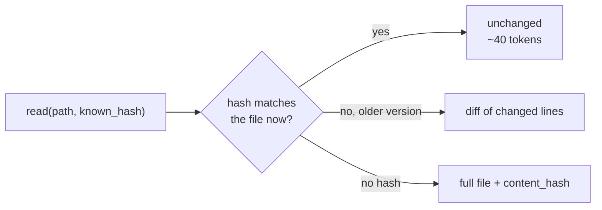

<p align="center">
  
</p>

<h1 align="center">Semantic Cache MCP</h1>

<p align="center">
  <strong>Stop paying for the same file twice.</strong><br />
  An MCP file cache for AI coding agents: a re-read costs ~40 tokens instead of the whole file.
</p>

<p align="center">
  <a href="https://pypi.org/project/semantic-cache-mcp/"></a>
  <a href="https://pypi.org/project/semantic-cache-mcp/"></a>
  <a href="https://www.python.org/downloads/"></a>
  <a href="LICENSE"></a>
</p>

<p align="center">
  <a href="https://glama.ai/mcp/servers/CoderDayton/semantic-cache-mcp"></a>
  &nbsp;
  <a href="https://ko-fi.com/U7U01WTJF9"></a>
</p>

<!-- mcp-name: io.github.CoderDayton/semantic-cache-mcp -->

---

Coding agents read the same files over and over: before an edit, after an edit, after every context compaction. A built-in `Read` sends the whole file each time. Semantic Cache MCP knows what your agent already holds. Measured on one 7,891-token file:

| Read | Built-in `Read` | Semantic Cache MCP |
|------|----------------:|-------------------:|
| First read | 7,891 tokens | full file, plus a hash |
| Re-read, file unchanged | 7,891 tokens | **77 tokens** |
| Re-read after a one-line edit | 7,891 tokens | **137 tokens** (a diff) |

Across a 48-file project it saves **98.7%** of re-read tokens, and an unchanged read takes **0.17 ms**. It also gives your agent `grep`, BM25 search and `glob` over the cache, atomic edits with `dry_run`, and token-budgeted batch reads. Three runtime dependencies, no API keys, no GPU.

## Quick start

You need [uv](https://docs.astral.sh/uv/getting-started/installation/). In Claude Code:

```bash
claude mcp add semantic-cache --scope user -- uvx semantic-cache-mcp
```

Any other client (Cursor, Claude Desktop, and others that take `mcpServers` JSON):

```json
{
  "mcpServers": {
    "semantic-cache": {
      "command": "uvx",
      "args": ["semantic-cache-mcp"]
    }
  }
}
```

Configs for VS Code, Codex and OpenCode, and how to turn off the built-in file tools so the agent uses the cache: **[docs/clients.md](docs/clients.md)**.

## How it works

Every file the server sends comes with a `content_hash`. The agent passes it back as `known_hash` on the next read:



- **No stale content.** Every read checks the file on disk first. `unchanged` only answers when the hash matches the current bytes.
- **Forgetting is safe.** After a compaction, the agent reads without the hash and gets the full file back.
- **Large files become maps.** A file over `max_size` returns an outline of its definitions, not a blind cut.
- **Everything stays local.** The cache is a SQLite file. One background daemon serves every client on your machine.

## Tools

`read` · `batch_read` · `read_image` · `write` · `edit` · `batch_edit` · `edit_preview` · `delete` · `warm` · `grep` · `search` · `glob` · `stats` · `clear`

Parameters and examples: **[docs/tools.md](docs/tools.md)**.

## FAQ

**Is the search "semantic" in the embeddings sense?** No. `search` is BM25 keyword ranking and `grep` is exact. No model to download, no GPU, no API key.

**Does it send my code anywhere?** No. The only network request is a one-time download of the o200k tokenizer file, checked against a SHA-256 hash.

**Does it work on Windows?** Yes. CI runs on Linux and macOS.

## Documentation

| Guide | Covers |
|-------|--------|
| [Clients](docs/clients.md) | Setup for each client, turning off built-in file tools |
| [Tools](docs/tools.md) | Every tool, with parameters and examples |
| [Environment Variables](docs/env_variables.md) | Every setting, with defaults |
| [Performance](docs/performance.md) | Benchmarks and methodology |
| [Architecture](docs/architecture.md) | Storage, algorithms, the shared daemon |
| [Security](docs/security.md) | Threat model, size limits, path handling |
| [Troubleshooting](docs/troubleshooting.md) | Common issues, debug logging |
| [Advanced Usage](docs/advanced-usage.md) | Python API |

## Contributing

```bash
git clone https://github.com/CoderDayton/semantic-cache-mcp.git
cd semantic-cache-mcp
uv sync --extra dev
uv run pytest
```

See [CONTRIBUTING.md](CONTRIBUTING.md). Issues and pull requests are welcome.

## License

[MIT](LICENSE).
